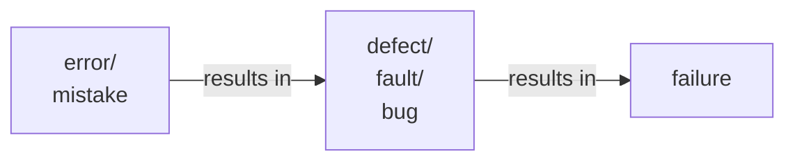

# Error vs defect vs bug vs fault vs failure

|  term   | definition                         |          cause          |     stage      |
| :-----: | ---------------------------------- | :---------------------: | :------------: |
|  error  | A human mistake in code or design. |    developer/tester     |  development   |
| defect  | A flaw in software.                | error in implementation |    testing     |
|   bug   | An informal term for defect.       |     same as defect      | same as defect |
|  fault  | Root cause in code.                | incorrect logic/design  |  development   |
| failure | System not working as expected.    | defect during execution |    runtime     |
